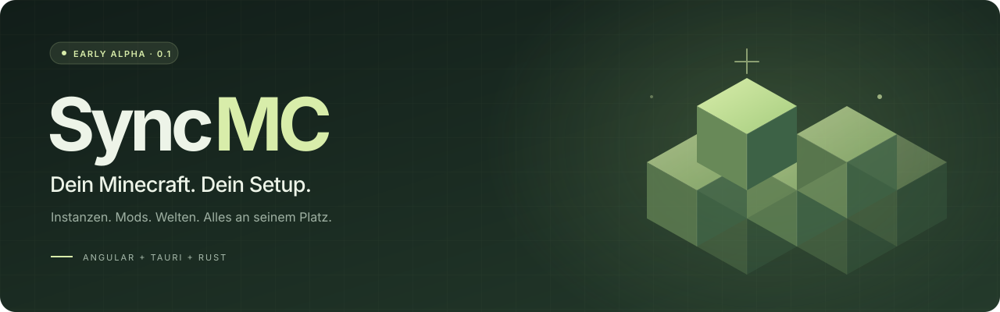
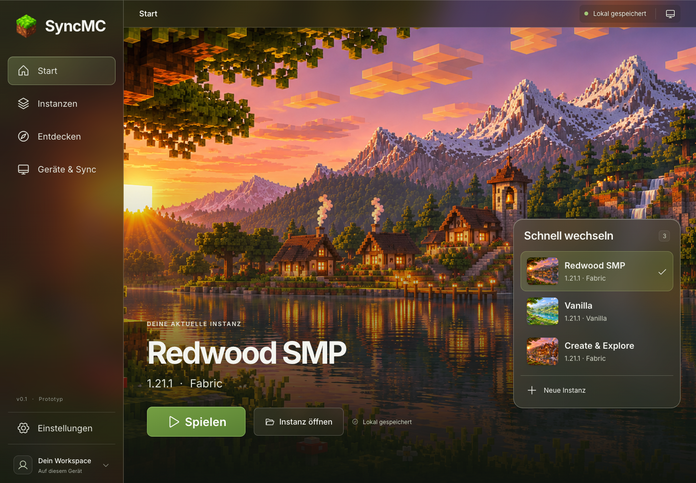
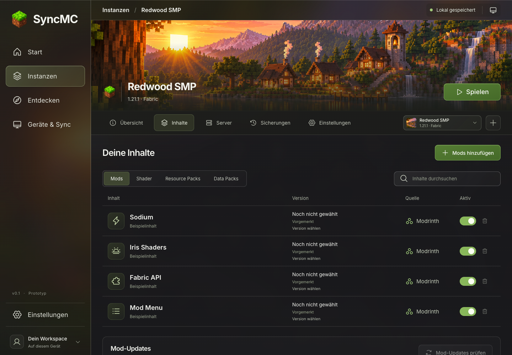
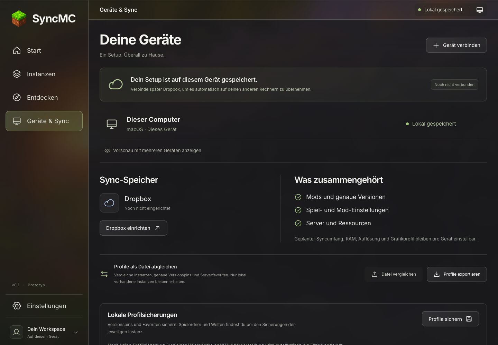

<p align="center">
  
</p>

<p align="center">
  Ein aufgeräumtes Zuhause für deine Minecraft-Java-Instanzen.<br>
  Mit gepinnten Mods, eigenen Welten und Einstellungen, die zu deinem Gerät passen.
</p>

<p align="center">
  <a href="https://github.com/playmonkeei/SyncMC/actions/workflows/ci.yml"></a>
  
  
  
  <a href="LICENSE"></a>
</p>

<p align="center">
  <a href="#ein-erster-blick">Ein erster Blick</a> ·
  <a href="#was-schon-drinsteckt">Features</a> ·
  <a href="#lokal-loslegen">Loslegen</a> ·
  <a href="#wo-die-reise-hingeht">Roadmap</a> ·
  <a href="CONTRIBUTING.md">Mitmachen</a>
</p>

---

## Dein Spielstand verdient einen guten Launcher.

Eine schlanke Vanilla-Welt. Ein sorgfältig zusammengestelltes Fabric-Setup. Ein neues Mod-Projekt. SyncMC gibt jeder Instanz ihren eigenen Platz und hält Versionen, Inhalte und Sicherungen zusammen.

Die Idee dahinter: **Das gemeinsame Profil beschreibt dein Setup. Dein Gerät bestimmt, wie es läuft.** Minecraft-Version, Modloader und konkrete Inhaltsversionen gehören zur Instanz; Java, RAM und Vollbild bleiben lokale Geräteeinstellungen. Profile lassen sich bereits per Datei abgleichen. Automatischer Cloud-Sync ist das nächste größere Ziel.

> [!IMPORTANT]
> **SyncMC ist eine frühe Alpha für Entwicklung und Feedback.** Vanilla-/Fabric-Installation, Inhaltsverwaltung und Sicherungen sind implementiert. Mojang hat den Antrag auf Minecraft-API-Zugang am 6. November 2026 genehmigt. Die echte Kontoanmeldung, das Speichern einer Welt und ihr erneutes Laden nach einem vollständigen App-Neustart wurden unter macOS ARM64 geprüft. Es gibt derzeit keine fertigen Installer. Details: [Anmeldung](docs/authentication.md) und [Inhaltsquellen](docs/content-sources.md).

## Ein erster Blick



<table>
  <tr>
    <td width="50%"></td>
    <td width="50%"></td>
  </tr>
  <tr>
    <td align="center"><sub>Alles für deine Instanz an einem Ort.</sub></td>
    <td align="center"><sub>Ein gemeinsames Profil. Ein eigenes Setup pro Gerät.</sub></td>
  </tr>
</table>

<sub>Browser-Vorschau mit den mitgelieferten Beispieldaten. Ohne angemeldetes Konto oder persönliche Profile.</sub>

## Was schon drinsteckt

| | Für dein nächstes Abenteuer |
| :--- | :--- |
| **Instanzen mit Charakter** | Panorama-Cover, schneller Wechsel, getrennte Inhalte und Serverfavoriten. |
| **Vanilla & Fabric** | Native Installation von Minecraft, Loader, Bibliotheken und Assets mit Prüfsummen und Dateireparatur. |
| **Inhalte mit festen Versionen** | Modrinth-Suche, konkrete Dateipins und rekursive Pflichtabhängigkeiten. CurseForge ist optional mit eigenem genehmigten API-Key angebunden. |
| **Java passend zum Gerät** | Lokale Installationen erkennen oder eine passende Eclipse-Temurin-Runtime mit SHA-256-Prüfung einrichten. |
| **Sicherungen & gezielte Updates** | Instanzen einschließlich Welten sichern, mit Rettungssicherung wiederherstellen und Mod-Updates einzeln auswählen. |
| **Profile zum Mitnehmen** | Validierter JSON-Export und Datei-Abgleich mit Vorschau, Konfliktauswahl und automatischer Profilsicherung. |

Die Oberfläche verwendet Angular und Signals, der native Kern Tauri und Rust. Installationen und Starts laufen in der Desktop-App. Die lokale Browser-Vorschau eignet sich zum Erkunden und Entwickeln der Oberfläche.

### Bewusst transparent

- **Anmeldung:** Die echte Microsoft-/Minecraft-Anmeldung einschließlich Spielberechtigung und Java-Profil wurde am 7. November 2026 unter macOS ARM64 bestätigt. Welt speichern, regulär beenden und nach vollständigem App-Neustart ohne neue Microsoft-Anmeldung erneut starten und die Welt laden sind geprüft. Die Abmeldeprüfung steht noch aus.
- **CurseForge:** Die native Anbindung ist technisch geprüft. Der zulässige Nutzungsumfang für eine öffentliche Distribution ist noch zu klären; es wird kein API-Key mitgeliefert.
- **Plattformen:** macOS ARM64 wurde lokal geprüft. Linux und Windows sind vorgesehen; CI prüft den nativen Kern auf allen drei Systemen. Das ersetzt noch keinen vollständigen App-Test pro Plattform.
- **Noch geplant:** Forge/NeoForge, automatischer Cloud-Sync und signierte Installer. Data Packs benötigen künftig eine konkrete Weltzuordnung.

## Lokal loslegen

Du brauchst **Node.js 24.16.0** (siehe [.nvmrc](.nvmrc)) und npm. Für die Desktop-App kommen [Rustup](https://rustup.rs/) und die [Tauri-Systemvoraussetzungen](https://v2.tauri.app/start/prerequisites/) hinzu. Rust wird durch [rust-toolchain.toml](rust-toolchain.toml) auf die Projektversion festgelegt.

```sh
git clone https://github.com/playmonkeei/SyncMC.git
cd SyncMC
npm ci
npm run dev
```

Öffne **http://127.0.0.1:4200** für die Browser-Vorschau.

Für die native App den Browser-Devserver zuerst beenden und starten:

```sh
npm run desktop
```

Die Desktop-App startet den Angular-Server selbst. Die mitgelieferten Instanzen enthalten **Beispielinhalte**; wähle echte Dateiversionen aus, bevor du eine Installation vorbereitest. Eine erste Fabric-Zusammenstellung findest du unter [docs/examples](docs/examples/first-fabric-instance.json).

| Befehl | Ergebnis |
| :--- | :--- |
| `npm test` | Tests für Versionsauswahl, Inhaltsgruppen und Profilabgleich |
| `npm run test:native` | Rust-Tests ohne die ausdrücklich optionalen großen Netzwerktests |
| `npm run build` | Produktionsbuild der Oberfläche |
| `npm run desktop:build` | Native Anwendung, aktuell ohne Installer |
| `npm run check:publication` | Lokale Prüfung der gestagten Dateien auf Veröffentlichungsrisiken |

Weitere Einrichtung, Architektur und optionale Integrationstests: **[Entwicklung](docs/development.md)**.

## Wo die Reise hingeht

- [x] Eigenständige Desktop-Oberfläche und lokale Instanzverwaltung
- [x] Vanilla-/Fabric-Installation, Inhalts-Pins und Pflichtabhängigkeiten
- [x] Java-Verwaltung, Instanzsicherungen und Profilabgleich
- [x] Mojang-Freigabe für den Minecraft-API-Zugang
- [x] Kontoanmeldung, Welt speichern und erneut laden nach App-Neustart unter macOS ARM64
- [ ] Abmeldung im echten Kontoablauf prüfen
- [ ] CurseForge-Nutzungsumfang für die Distribution klären
- [ ] App-Abnahme unter Windows und Linux
- [ ] Signierte Builds und Installer
- [ ] Automatischer Cloud-Sync mit bewusster Konfliktauflösung
- [ ] Forge und NeoForge

## Tiefer einsteigen

| | |
| :--- | :--- |
| [Entwicklung](docs/development.md) | Setup, Projektstruktur, Builds und Tests |
| [Anmeldung](docs/authentication.md) | Microsoft-Konto, Token-Speicherung und Freigabestand |
| [Inhaltsquellen](docs/content-sources.md) | Modrinth, CurseForge, Dateipins und Downloadprüfung |
| [Java & Wiederherstellung](docs/runtime-and-recovery.md) | Runtimes, Backups, Profil-Export und Datei-Abgleich |
| [Mitmachen](CONTRIBUTING.md) | Fehler melden, Ideen einbringen und Änderungen vorbereiten |
| [Sicherheit](SECURITY.md) | Vertrauliche Hinweise und sichere Fehlerberichte |
| [Bildmaterial](docs/assets.md) | Herkunft der Illustrationen und App-Grafiken |

## Gemeinsam weiterbauen

Eine gute Idee, ein reproduzierbarer Fehler oder ein klarer Pull Request hilft weiter. Schau in [CONTRIBUTING.md](CONTRIBUTING.md) oder [eröffne ein Issue](https://github.com/playmonkeei/SyncMC/issues/new/choose). Bitte prüfe Screenshots und Logs vor dem Teilen auf Kontodaten, Tokens und persönliche Pfade.

SyncMC steht unter **[GNU GPL v3.0](LICENSE)** (`GPL-3.0-only`). Bibliotheken und Drittanbieterinhalte behalten ihre jeweiligen Lizenzen.

<p align="center"><sub>Ein unabhängiges Projekt von <a href="https://github.com/playmonkeei">playmonkeei</a>.<br>Kein offizielles Minecraft-Produkt. Nicht von Mojang oder Microsoft genehmigt oder mit ihnen verbunden.</sub></p>
